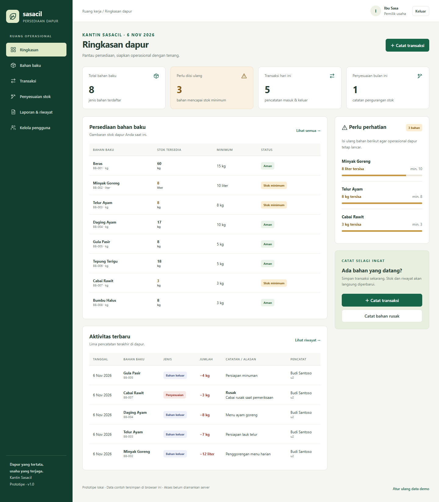

# SasaStok

**Dapur yang tertata, usaha yang terjaga.**

SasaStok adalah aplikasi web manajemen bahan baku Kantin Sasacil untuk memantau persediaan, mencatat bahan masuk dan keluar, mengelola penyesuaian stok, serta meninjau laporan. Pemilik usaha dan karyawan menggunakan antarmuka sesuai kewenangannya.

**Buka web:** [https://xavleflip.github.io/Inventory-Management/](https://xavleflip.github.io/Inventory-Management/)

Versi ini menggunakan HTML, CSS, dan JavaScript dengan penyimpanan pada browser. Hosting menyediakan berkas aplikasi; stok dan akun belum tersimpan pada server bersama. Baca bagian penyimpanan serta batasan sebelum menggunakan data operasional.



## Cara Membuka Aplikasi

### Melalui hosting

1. Buka [SasaStok](https://xavleflip.github.io/Inventory-Management/) menggunakan browser terbaru.
2. Masukkan email dan kata sandi akun aktif.
3. Gunakan menu sesuai peran: **Ringkasan**, **Bahan baku**, **Transaksi**, **Penyesuaian stok**, **Laporan & riwayat**, dan **Kelola pengguna** khusus pemilik.

Akun dan perubahan stok pada satu browser tidak otomatis muncul pada perangkat atau browser lain, meskipun alamat webnya sama. Akses pertama ke hosting memerlukan internet; aplikasi belum menyediakan service worker untuk menjamin hosting dapat dibuka secara offline.

### Melalui berkas lokal

1. Pastikan `index.html`, `style.css`, `model.js`, dan `app.js` berada dalam folder yang sama.
2. Buka `index.html` menggunakan Chrome, Edge, atau Brave terbaru.
3. Jika browser membatasi berkas lokal atau penyimpanan, gunakan server lokal di bawah.

Tidak diperlukan instalasi paket, kompilasi, atau konfigurasi database. Berkas aplikasi lokal tidak bergantung pada CDN dan dapat digunakan tanpa internet.

### Melalui server lokal

Pastikan Python 3 tersedia, lalu jalankan melalui PowerShell:

```powershell
Set-Location -LiteralPath 'D:\Kuliah\Semester 5\KWU\bab 2\sasacil'
python -m http.server 8765 --bind 127.0.0.1
```

Buka [http://127.0.0.1:8765](http://127.0.0.1:8765). Tekan `Ctrl+C` untuk menghentikan server. Membuka berkas langsung tidak memerlukan Python.

## Akun Awal dan Login

Jika belum ada data tersimpan, aplikasi membuat akun awal berikut beserta bahan dan transaksi contoh bawaan:

| Peran | Email | Kata sandi awal |
| --- | --- | --- |
| Pemilik usaha | `pemilik@sasacil.id` | `sasacil123` |
| Karyawan | `karyawan@sasacil.id` | `sasacil123` |

Data bawaan membantu memahami alur aplikasi dan bukan catatan operasional yang telah diverifikasi. Pada browser yang sudah pernah digunakan, aplikasi mempertahankan data serta akun yang ada.

1. Isi **Email** dan **Kata sandi**, lalu tekan **Masuk ke aplikasi**.
2. Kredensial salah atau akun nonaktif akan ditolak.
3. Pemilik dapat mengganti sandi melalui **Kelola pengguna → Ubah**. Gunakan sandi berbeda untuk akun sendiri; perubahan tetap hanya berlaku pada penyimpanan browser tersebut.
4. Tekan **Keluar** di bagian atas untuk mengakhiri sesi.

Kredensial awal tidak ditampilkan pada halaman login. Hubungi pengelola jika akun tidak dapat digunakan. Belum tersedia pendaftaran mandiri atau pemulihan sandi melalui email.

## Fitur dan Hak Akses

| Fitur | Pemilik usaha | Karyawan |
| --- | --- | --- |
| Ringkasan, daftar stok, dan peringatan minimum | Melihat | Melihat |
| Pencarian bahan dan filter status stok | Menggunakan | Menggunakan |
| Tambah, ubah, hapus master bahan sesuai aturan | Mengelola | Tidak tersedia |
| Penetapan minimum stok | Mengelola | Tidak tersedia |
| Bahan masuk dan keluar | Mencatat | Mencatat |
| Penyesuaian bahan rusak, kedaluwarsa, atau hilang | Mencatat | Mencatat |
| Riwayat dan filter tanggal, bahan, serta jenis | Melihat | Melihat |
| Rekap persediaan dan ekspor CSV | Tersedia | Tidak tersedia |
| Pengelolaan akun, peran, sandi, dan status | Mengelola | Tidak tersedia |

## Panduan Setiap Menu

### 1. Ringkasan

- **Total bahan baku:** jumlah jenis bahan, bukan penjumlahan kuantitas dengan satuan berbeda.
- **Perlu diisi ulang:** jumlah bahan yang saldonya kurang dari atau sama dengan minimum.
- **Transaksi hari ini:** jumlah catatan masuk dan keluar hari ini; penyesuaian dihitung terpisah.
- **Penyesuaian bulan ini:** jumlah catatan penyesuaian bulan berjalan.
- Tabel persediaan menampilkan saldo, minimum, dan status **Stok habis** jika saldo 0, **Stok minimum** jika saldo di atas 0 sampai batas minimum, atau **Aman** jika saldo melebihi minimum. Filter status membedakan ketiga kondisi tersebut. Bahan habis tetap dihitung dalam bagian Perlu diisi ulang dan Perlu perhatian.
- Panel **Perlu perhatian** menampilkan bahan yang perlu diperiksa atau diisi ulang.
- **Aktivitas terbaru** menampilkan lima pencatatan terbaru. Tombol **Catat transaksi**, **Catat bahan rusak**, **Lihat semua**, dan **Lihat riwayat** membuka menu terkait.

### 2. Bahan baku

**Mencari dan menyaring:** isi nama atau kode pada **Cari bahan**, pilih **Status stok**, lalu tekan **Terapkan**. Untuk menampilkan semua, kosongkan pencarian, pilih **Semua status**, dan terapkan kembali.

**Menambah — pemilik:** tekan **Tambah bahan**, isi kode unik, nama, satuan (`kg`, `liter`, `pcs`, atau `gram`), saldo awal, dan batas minimum. Tekan **Simpan bahan**. Gunakan **Batal** atau tombol tutup untuk membatalkan.

**Mengubah — pemilik:** tekan **Ubah** pada baris bahan, sesuaikan isian, dan simpan. Setelah bahan memiliki transaksi, saldo awal dan satuannya dikunci. Kode, nama, serta minimum tetap dapat diperbarui. Perubahan stok operasional dilakukan melalui transaksi.

**Menghapus — pemilik:** tekan **Hapus**, baca konfirmasi, lalu pilih **Konfirmasi** atau **Batal**. Bahan yang memiliki riwayat tidak dapat dihapus; penghapusan hanya untuk master tanpa riwayat.

Karyawan hanya melihat daftar, pencarian, dan filter tanpa tombol pengelolaan master.

### 3. Transaksi

1. Pilih **Bahan masuk** untuk penerimaan atau **Bahan keluar** untuk pemakaian dapur.
2. Pilih bahan; daftar menampilkan kode, nama, saldo, dan satuan.
3. Isi jumlah positif, tanggal, serta catatan opsional.
4. Periksa perkiraan saldo dan identitas pencatat, kemudian tekan **Simpan transaksi**.

Bahan masuk menambah stok; bahan keluar menguranginya. Pengeluaran yang membuat saldo negatif ditolak. Pratinjau memperlihatkan perubahan terhadap stok terkini, sedangkan pemeriksaan saat menyimpan juga memeriksa urutan transaksi bertanggal. Transaksi mundur tanggal dapat ditolak meskipun perkiraan saldo terkini terlihat cukup.

Pencatatan yang berhasil langsung memperbarui saldo dan riwayat. **Pencatatan terbaru** menampilkan hingga sepuluh catatan masuk/keluar. Pencatat diisi otomatis dari akun yang sedang masuk. Belum tersedia pengubahan atau penghapusan transaksi yang sudah disimpan; periksa isian sebelum menyimpan.

### 4. Penyesuaian stok

1. Pilih bahan yang akan dikurangi.
2. Pilih alasan **Rusak**, **Kedaluwarsa**, atau **Hilang**.
3. Isi jumlah dan tanggal.
4. Isi **Keterangan spesifik**, misalnya kondisi bahan atau penyebab kehilangan; kolom ini wajib.
5. Periksa perkiraan saldo dan identitas pencatat, lalu tekan **Simpan penyesuaian**.

Penyesuaian selalu mengurangi stok dan tidak boleh menyebabkan saldo negatif. Riwayat menampilkan alasan, keterangan, dan identitas pencatat. Penambahan persediaan dilakukan melalui **Bahan masuk**, bukan penyesuaian.

### 5. Laporan & riwayat

**Filter:** pilih **Dari tanggal**, **Sampai tanggal**, **Bahan baku**, dan/atau **Jenis**, lalu tekan **Terapkan**. Isian boleh dikosongkan untuk menampilkan seluruh data. Tanggal awal tidak boleh melewati tanggal akhir; kedua batas tanggal termasuk dalam hasil. Tekan **Reset** untuk membersihkan filter laporan saja.

Riwayat menampilkan tanggal, bahan, jenis, jumlah, catatan/alasan, nama pencatat, dan ID pengguna.

**Rekap persediaan — pemilik:** menampilkan saldo awal periode, total masuk, total keluar, penyesuaian, serta saldo akhir periode. Rekap mengikuti tanggal dan bahan, tetapi selalu menghitung seluruh jenis pergerakan. Filter **Jenis** hanya memengaruhi tabel riwayat. Jika tanggal awal kosong, perhitungan dimulai dari saldo awal bahan.

**Ekspor — pemilik:**

- **Ekspor riwayat CSV:** mengunduh riwayat sesuai filter dengan nama `sasastok-riwayat-YYYY-MM-DD.csv`.
- **Ekspor stok CSV:** mengunduh rekap dengan nama `sasastok-persediaan-YYYY-MM-DD.csv`.
- Buka berkas menggunakan Excel atau LibreOffice. Jika data tampil dalam satu kolom, gunakan impor teks/CSV dengan pemisah koma dan encoding UTF-8.

CSV merupakan laporan, bukan cadangan lengkap akun dan aplikasi. Belum ada impor CSV atau pemulihan data dari CSV.

### 6. Kelola pengguna — pemilik

**Menambah:** tekan **Tambah pengguna**, isi nama, email unik, peran (**Karyawan** atau **Pemilik usaha**), status (**Aktif** atau **Nonaktif**), dan sandi minimal enam karakter. Tekan **Simpan pengguna**.

**Mengubah akun/sandi:** tekan **Ubah**. Perbarui nama, email, peran, atau status. Isi **Kata sandi baru** untuk menggantinya; kosongkan untuk mempertahankan sandi lama. Simpan perubahan.

**Menonaktifkan:** melalui **Ubah**, pilih **Nonaktif**, lalu simpan. Akun tidak dapat login pada penyimpanan browser ini; riwayat pencatatannya tetap ada.

**Menghapus:** tekan **Hapus** dan konfirmasikan. Akun dengan riwayat tidak dapat dihapus; nonaktifkan sebagai gantinya. Akun pemilik yang sedang dipakai tidak dapat dihapus, dinonaktifkan, atau diturunkan perannya. Minimal satu pemilik harus tetap aktif.

## Aturan Perhitungan dan Validasi

```text
Stok terkini = saldo awal + bahan masuk − bahan keluar − penyesuaian
```

- Saldo awal dan minimum boleh nol; jumlah transaksi harus lebih besar dari nol.
- Jumlah maksimal dua desimal. Nilai disimpan secara internal sebagai bilangan bulat per 1/100 satuan untuk menghindari akumulasi galat pecahan.
- Satuan mengikuti bahan. Tidak ada konversi otomatis, misalnya antara kg dan gram.
- Tanggal tidak boleh melewati hari ini berdasarkan zona `Asia/Jakarta`.
- Transaksi mundur tanggal diperiksa terhadap seluruh lintasan saldo; transaksi bertanggal sama mengikuti urutan pencatatan.
- Peringatan minimum aktif ketika saldo **kurang dari atau sama dengan** ambang minimum.
- Nama pencatat saat transaksi disimpan ikut direkam agar penelusuran tetap tersedia setelah akun diperbarui.

## Penyimpanan dan Sesi

Data tersimpan di `localStorage`. Kunci lama `sasacil-prototype-v1` sengaja dipertahankan agar pergantian nama menjadi SasaStok tidak menghilangkan data yang sudah ada.

- Memuat ulang mempertahankan data, tetapi pengguna perlu masuk kembali.
- Data terpisah antarbrowser, profil, dan asal situs. Berkas lokal, localhost, serta GitHub Pages menggunakan penyimpanan berbeda. Perubahan port localhost juga mengganti asal situs.
- Pada hosting, akun yang dibuat di laptop tidak otomatis tersedia di ponsel; belum ada layanan akun terpusat.
- Mode privat dapat menghapus data setelah sesi ditutup. Menghapus data situs juga menghapus catatan aplikasi.
- Perubahan tab lain meminta login ulang. Pemeriksaan revisi menolak konflik yang terdeteksi, tetapi tidak menyediakan transaksi atomik seperti database.

Tombol pengisian akun demo dan pengaturan ulang seluruh data telah dihapus. **Reset** pada laporan hanya membersihkan filter, bukan menghapus stok atau akun. Jangan menghapus penyimpanan situs sebagai langkah penanganan masalah rutin karena pemulihan lengkap belum tersedia.

## Palet Warna Antarmuka

| Warna | Kode | Penggunaan |
| --- | --- | --- |
| Kuning | `#F6C445` | Logo, kartu peringatan, dan penanda stok minimum |
| Oranye | `#F05A28` | Tombol utama, aksen navigasi, dan indikator perhatian |
| Hijau | `#8BC34A` | Menu aktif serta status stok aman |
| Krem | `#FFF3D6` | Latar halaman dan teks pada bidang gelap |
| Cokelat gelap | `#3B2F2F` | Sidebar, teks utama, dan identitas visual |

Warna pendukung yang lebih terang/gelap digunakan untuk permukaan, batas, teks sekunder, serta menjaga keterbacaan. Teks tombol oranye menggunakan cokelat yang lebih gelap, bukan putih. Status stok tetap memiliki label teks agar tidak hanya dibedakan melalui warna.

## Struktur dan Teknologi

```text
sasacil/
├── index.html              # Halaman awal dan judul SasaStok
├── style.css               # Tampilan responsif
├── model.js                # Logika stok, akun, validasi, filter, dan CSV
├── app.js                  # Antarmuka, interaksi, dan penyimpanan lokal
├── README.md               # Dokumentasi utama dan panduan seluruh menu
├── PETUNJUK.md             # Pengarah ke dokumentasi utama
├── VERIFIKASI.md           # Riwayat pemeriksaan
├── pratinjau-login.png     # Tampilan login
├── pratinjau-desktop.png   # Tampilan komputer
└── pratinjau-mobile.png    # Tampilan layar kecil
```

Aplikasi menggunakan HTML/CSS, JavaScript tanpa framework, `localStorage`, Web Crypto, serta Blob/URL objek untuk ekspor. Kata sandi disimpan sebagai hash PBKDF2-SHA-256 dengan salt acak dan 100.000 iterasi. Tidak ada dependensi aplikasi yang perlu dipasang.

`model.js` bertanggung jawab atas aturan data; `app.js` menghubungkannya dengan antarmuka dan penyimpanan. Pertahankan validasi stok pada model agar semua formulir menggunakan aturan yang sama.

## Batasan dan Keamanan

Perapian tampilan tidak mengubah arsitektur penyimpanan atau menjadikannya layanan produksi yang aman. Autentikasi dan peran diperiksa di browser, tempat JavaScript dan data dapat dimodifikasi. Kredensial awal dan data bawaan tetap ada pada inisialisasi; menghilangkan tampilannya dari login bukan pengamanan server.

Versi ini belum memiliki backend Laravel/PHP/MySQL, database bersama, otorisasi server, pemulihan sandi melalui email, pencadangan lengkap, atau sinkronisasi antarperangkat. Penggunaan usaha dengan data sebenarnya memerlukan server, sesi aman, validasi dan otorisasi server, transaksi database/penguncian stok, serta cadangan dan pemulihan. Gunakan data non-sensitif selama arsitektur tersebut belum tersedia.

## Pemeliharaan Hosting

Tautan proyek: [SasaStok di GitHub Pages](https://xavleflip.github.io/Inventory-Management/). Perubahan pada folder lokal tidak otomatis mengubah hosting. Unggah/push perubahan ke repositori `Inventory-Management` dan gunakan konfigurasi publikasi GitHub Pages yang sudah ditetapkan. Sesudah publikasi selesai, muat ulang halaman untuk memeriksa versi terbaru.

Pembaruan berkas pada asal situs yang sama mempertahankan data selama penyimpanan tidak dihapus. Belum tersedia migrasi otomatis jika asal situs berubah.

## Penyelesaian Masalah

| Masalah | Tindakan yang disarankan |
| --- | --- |
| Berkas lokal tidak dapat dibuka | Pastikan berkas lengkap, izinkan JavaScript/penyimpanan, lalu coba server lokal. |
| Login ditolak | Periksa email, sandi, status aktif, serta browser/alamat. Hubungi pemilik untuk memeriksa akun. |
| Akun awal tidak berfungsi | Akun pada browser tersebut mungkin sudah diubah atau dinonaktifkan; gunakan pemilik aktif lain jika tersedia. |
| Data hosting, lokal, atau ponsel berbeda | Penyimpanannya terpisah; kembali ke browser dan alamat asal data. Belum ada sinkronisasi. |
| Stok keluar ditolak walaupun saldo terkini cukup | Periksa jumlah, satuan, tanggal, serta lintasan saldo setelah transaksi mundur tanggal. |
| Bahan atau pengguna tidak bisa dihapus | Data memiliki riwayat atau merupakan akun yang dilindungi. Nonaktifkan pengguna bila memungkinkan. |
| Perubahan bertabrakan dengan tab lain | Masuk/muat ulang sesuai pesan, periksa data terbaru, lalu ulangi tindakan sekali. Hindari simpan serentak. |
| CSV terbuka sebagai satu kolom | Impor sebagai CSV dengan pemisah koma dan encoding UTF-8. |
| Menu atau tabel tidak terlihat lengkap di layar kecil | Geser navigasi/tabel secara horizontal; gulir halaman untuk bagian di bawah layar. |
| Hosting masih memperlihatkan tampilan lama | Periksa hasil publikasi Pages dan muat ulang. Perubahan lokal belum tentu sudah terunggah. |
| Data hilang setelah penyimpanan dihapus | CSV hanya membantu meninjau catatan yang diekspor; belum ada pemulihan penuh. Hubungi pengelola. |

## Dokumentasi dan Verifikasi

README menjadi panduan utama seluruh menu. [PETUNJUK.md](PETUNJUK.md) mengarah ke dokumen ini agar tidak ada petunjuk operasional ganda yang berbeda. [VERIFIKASI.md](VERIFIKASI.md) menyimpan hasil pemeriksaan terdahulu dan pembaruan SasaStok.

Pratinjau: [login](pratinjau-login.png), [komputer](pratinjau-desktop.png), dan [layar kecil](pratinjau-mobile.png).

Laporan awal 8 November 2026 berisi 24 halaman dan 18 screenshot versi sebelum pembaruan identitas. Laporan tersimpan terpisah dari folder ini dan bukan panduan tampilan SasaStok terbaru.

### Perubahan 16 November 2026

- Identitas dan judul menggunakan **SasaStok** dengan tagline **Stok tertata, dapur siap.**
- Login menggunakan formulir akun biasa tanpa kredensial publik maupun tombol pengisian akun demo.
- Label prototipe/demo dan tombol pengaturan ulang data dihapus dari antarmuka; penanganan aksi reset juga dihapus.
- Kunci penyimpanan dan aturan stok dipertahankan agar data lama tetap terbaca.
- Nama unduhan laporan menggunakan awalan `sasastok-`.
- Panduan seluruh menu dan tautan hosting dihimpun dalam README.

- Palet antarmuka mengikuti warna yang dipilih pengelola: kuning, oranye, hijau, krem, dan cokelat gelap.
